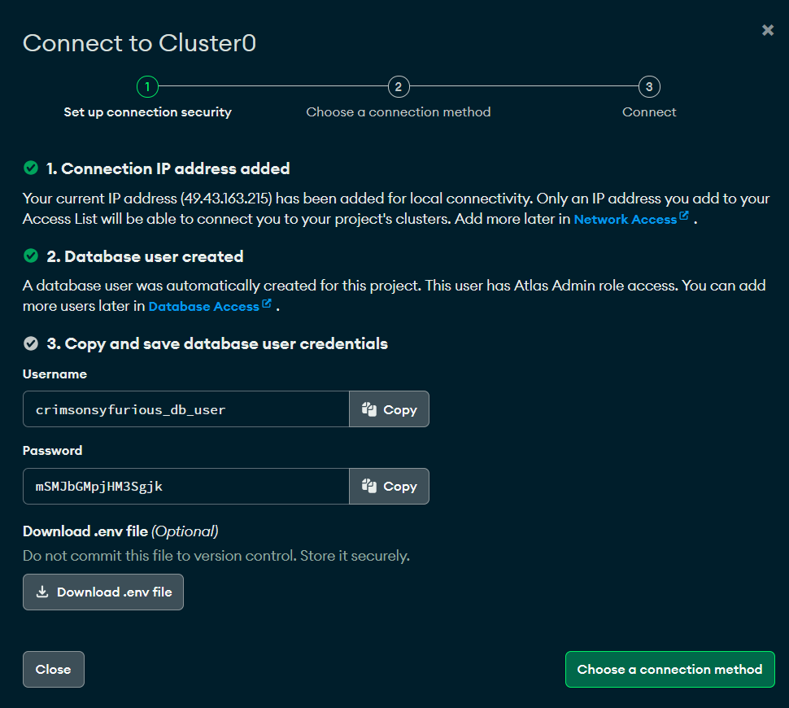
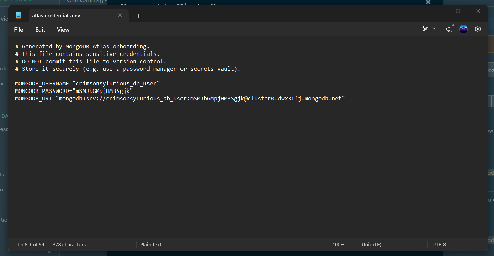

## To make this working you have to follow the steps:

### It is mandatory to have latest version of python installed.

### Step - 1 (Run these commands in terminal of the clones repository)

`python -m venv venv`

`.\venv\Scripts\activate.bat`

> if after running this command it shows Execution Script disabled problem then 
> perform below operation in terminal

`./venv/Scripts(Set-ExecutionPolicy -Scope Process -ExecutionPolicy RemoteSigned) ; (& c:\Users\khc07\Documents\GitHub\Management\venv\Scripts\Activate.ps1)`

`pip install flask pymongo dotenv pillow flask-cors`

`python index.py`

If it shows `pymongo.errors.ConfigurationError: Empty host (or extra comma in host list)` this error then we are good to go now we need a database.

**There are two ways through which you can do this operation**
1. You go onto mongodb atlas site and create a account it will give you a free very limited database.

2. You can download mongodb community server and compass then create a local database after that perform this operation

Now after you creating a database
copy the connection string and paste it into the .env file 

For ex.
`mongo_db = 'Your connection string'`

If you are considering first options by chossing MongoDB atlas then
you can download the atlas-credentials.env file

*The connection string is in double quotes in front of MONGODB_URI*

All doing all this long shit do 
`python index.py`

> * Serving Flask app 'index'
> * Debug mode: on
>WARNING: This is a development server. Do not use it in a production deployment. Use a production WSGI server instead.
> * Running on http://127.0.0.1:5000
>Press CTRL+C to quit
> * Restarting with stat
> * Debugger is active!
> * Debugger PIN: 523-931-293

If it show this in your terminal that means everything is working

Now open `http://localhost:5000/` in your browser.

That's It Now Enjoy!!!

---

This app works in this way where you first add a fee structure then do a entry after that you can pay that student fees using the custom right click menu

> a typical School Management System

*i don't know if it's cool or not but it's is all written by myself in 2 months for backend and 1 month for frontend*

**Note - Please use your own mongo db database because by this time mine is destroyed by MongoDB**